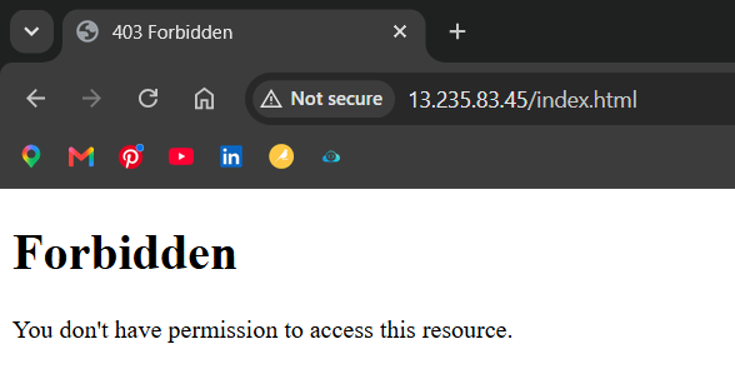
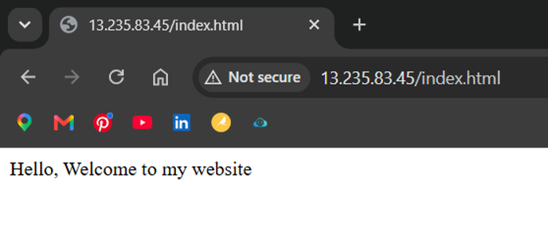

# jenkins-assignment
jenkins-assignment
ASSIGNMENT 1
create a Jenkins job to install apache httpd, start apache httpd, and deploy index.html on apache httpd server.

Execute shell command for following task ---

yum install httpd -y
systemctl start httpd
systemctl enable httpd
echo "Hello, Welcome to my website" > /var/www/html/index.html

but encountered with this error
 
To fix this I had change index file permission 
yum install httpd -y
systemctl start httpd
systemctl enable httpd
echo "Hello, Welcome to my website" > /var/www/html/index.html
chmod 666 /var/www/html/index.html

